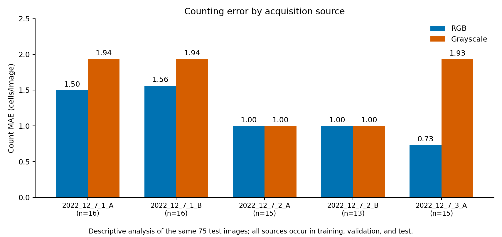
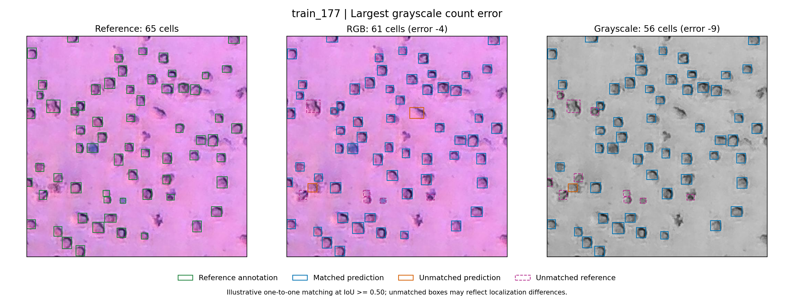
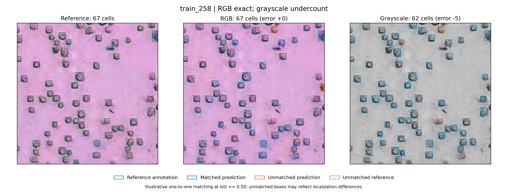
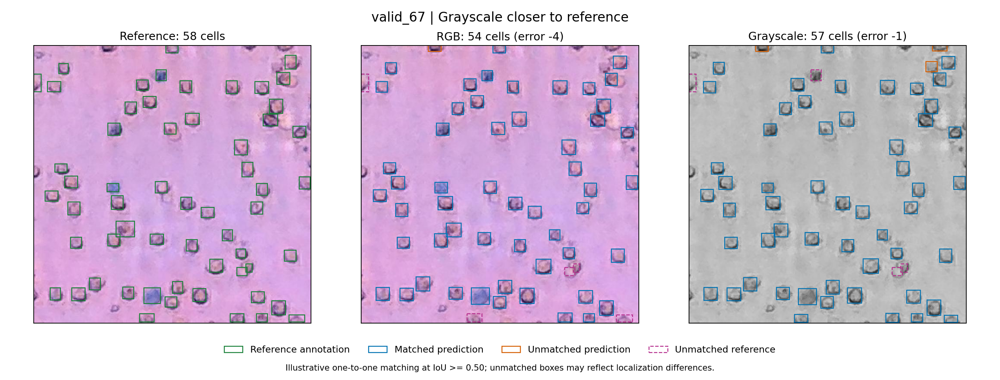

# RGB and grayscale: source and image diagnostics

Contributor: Ruiping Huang. See the [main results report](rgb_grayscale_results.md) and [experiment notebook](../notebooks/03a_rgb_grayscale.ipynb).

This analysis describes the completed seed-0 experiment. It does not train a new model, select new thresholds, or replace the original test results.

## Counting error by acquisition source

Source labels were joined to the 75 saved test predictions using the frozen manifest UID. Each image belongs to exactly one source.

| Source | Test images | RGB MAE | Grayscale MAE | Grayscale minus RGB |
|---|---:|---:|---:|---:|
| 2022_12_7_1_A | 16 | 1.500 | 1.938 | +0.438 |
| 2022_12_7_1_B | 16 | 1.562 | 1.938 | +0.375 |
| 2022_12_7_2_A | 15 | 1.000 | 1.000 | 0.000 |
| 2022_12_7_2_B | 13 | 1.000 | 1.000 | 0.000 |
| 2022_12_7_3_A | 15 | 0.733 | 1.933 | +1.200 |

MAE is measured in cells per image. Values are rounded; the [source table](results/rgb_grayscale/diagnostics/per_source_metrics.csv) retains full precision. Weighted source MAEs recover the original overall results, 1.173 for RGB and 1.587 for grayscale.

Grayscale has higher MAE in three sources and equal MAE in two. Source 3_A accounts for 18 of the 31 additional absolute count errors across the test set. This is a descriptive pattern, not evidence that background color caused the difference. Sources differ in other image properties and cell counts, each subgroup has only 13 to 16 images, and the experiment uses one seed and unequal realized training lengths. All five sources occur in training, validation, and test, so this is not an unseen-source evaluation.

## Case selection and verification

Six cases were selected deterministically from the saved count errors: the largest grayscale error; the largest grayscale undercount among RGB-exact images; the greatest grayscale count improvement; the largest combined error among shared overcounts; the largest combined error among shared undercounts; and a shared exact-count case closest to the test mean. Earlier selected cases were excluded and ties were resolved by UID. These intentionally selected examples do not estimate population error frequencies.

Saved `best.pt` checkpoint hashes were verified. Supplementary CPU inference used Ultralytics 8.4.183, image size 640, prediction floor 0.01, maximum 1,000 detections, and the existing validation-selected thresholds, RGB 0.44 and grayscale 0.33. All 75 counts in each arm matched the original GPU evaluation exactly. The original metric tables and timing measurements were retained. All 75 decoded RGB image hashes matched the formal-run image inventory.

Reference boxes in these figures come from the locally cached Version 1 COCO annotations converted to YOLO coordinates. Their image identities and annotation counts match the frozen manifest, but coordinate equality against the formal Roboflow YOLO export has not been directly verified. The figures support qualitative inspection; the matching counts below are not a new test detection benchmark.

The three selected figures below show reference annotations, RGB predictions, and grayscale predictions. Reference boxes are green. In prediction panels, blue boxes have a one-to-one reference match with intersection over union (IoU) at least 0.50; orange boxes are unmatched predictions; dashed magenta boxes are unmatched references. A box can be unmatched because of localization or annotation differences, so unmatched does not automatically mean a missing or spurious cell.

| Case | Reference | RGB | Grayscale | Reason for inclusion |
|---|---:|---:|---:|---|
| train_177 | 65 | 61 | 56 | Largest grayscale count error |
| train_258 | 67 | 67 | 62 | RGB exact; grayscale undercounts |
| valid_67 | 58 | 54 | 57 | Grayscale is closer to reference |
| train_207 | 44 | 48 | 49 | Both models overcount |
| train_243 | 61 | 58 | 57 | Both models undercount |
| valid_7 | 56 | 56 | 56 | Both counts are exact |

All six selected cases in the table are held-out test images in the frozen manifest. The `train_` and `valid_` filename prefixes refer to the original export, not this experiment's membership.

### Largest grayscale error

On `train_177`, RGB has 6 unmatched references and 2 unmatched predictions; grayscale has 10 and 1, respectively, under the illustrative matching rule. The net count errors are -4 and -9. The overlays locate candidate misses for review, but do not establish that loss of color caused them.

### Exact count can hide detection discrepancies

RGB predicts the correct total of 67 on `train_258`, but has 2 unmatched references and 2 unmatched predictions. Their effects cancel in the total count. Grayscale has 6 unmatched references and 1 unmatched prediction, giving a net error of -5. Count accuracy alone cannot establish complete cell-level detection accuracy.

### A case favoring grayscale

On `valid_67`, grayscale is closer in total count, 57 versus reference 58, while RGB predicts 54. Grayscale has 4 unmatched references and 3 unmatched predictions, compared with 5 and 1 for RGB. The better total does not imply uniformly better localization or fewer unmatched predictions. Across all test images, grayscale has lower absolute count error on 17, equal error on 27, and higher error on 31.

## Implications for the next iteration

Retain RGB as the current reference configuration. Review ambiguous and border annotations with the team, and agree on an explicit detection evaluation rule alongside count MAE. Repeated seeds or a fixed-epoch comparison would test training variability or budget effects separately. Any training changes should be selected using validation data. Follow-up results on the already-inspected test set should be identified as exploratory.

The [selected cases](results/rgb_grayscale/diagnostics/selected_cases.csv), [illustrative box matches](results/rgb_grayscale/diagnostics/illustrative_box_matches.csv), and [verification record](results/rgb_grayscale/diagnostics/verification.json) accompany these figures. The [diagnostics module](../src/cellcount/rgb_grayscale_diagnostics.py) reproduces the summaries and figures from the completed checkpoints and prepared data; it does not call training. Regenerated files go to ignored outputs rather than overwriting these published figures or tables. See the results report for the command and required external artifacts.
