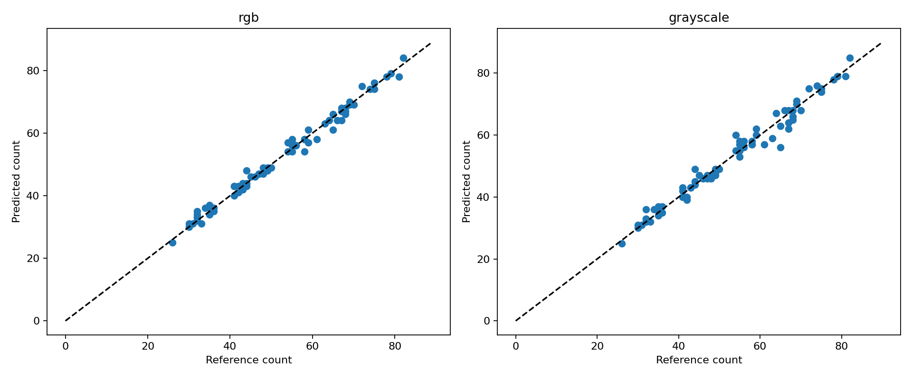

# RGB and grayscale cell counting: results

RGB inputs produced lower count error in this seed-0 experiment: **MAE 1.173 cells/image**, compared with **1.587** for grayscale, on the same 75 held-out images. Grayscale increased MAE by 0.413 cells/image. This run does not support replacing RGB with grayscale under the tested protocol.

## Experiment

Run: `rgb_grayscale_seed0_20261026T040157Z` (2026-10-26 UTC; 2026-10-25 America/Chicago).

The Roboflow Version 1 YOLO26 export contained 500 unique images and 26,715 boxes. Image identities and per-image annotation counts matched the team's frozen manifest. The split was reconstructed as 351 training, 74 validation, and 75 test images. Every Live and Dead box was retained and relabeled as Cell.

Both arms used YOLO26n, the same official pretrained checkpoint, seed 0, batch size 16, 640-pixel inputs, a maximum of 100 epochs, and early-stopping patience 20. RGB images and three-channel luminance images had identical geometry and labels. Training augmentation was limited to horizontal/vertical flips and uniformly sampled right-angle rotations. Other random augmentation was disabled. Geometry checks passed before training, and the actual transform pipeline was verified at each training start.

Both runs used a Tesla T4 with Python 3.13.16, PyTorch 2.11.0+cu130, Ultralytics 8.4.183, and Albumentations 2.0.8. The automatic optimizer selection resolved to AdamW with a logged initial learning rate of 0.002 in both arms. Saved training arguments differed only in dataset and output paths/names.

## Training and validation selection

| Item | RGB | Grayscale |
|---|---:|---:|
| Completed epochs | 100 | 39 |
| Reported training duration | 15.42 min | 5.46 min |
| Stopping outcome | Maximum epochs reached | No validation-fitness improvement for 20 epochs |
| Confidence threshold | 0.44 | 0.33 |
| Validation count MAE | 1.230 | 1.568 |

The grayscale log identifies epoch 19 as its best checkpoint. Both arms used their validation-selected `best.pt`; this was a shared stopping-rule comparison, not an equal-epoch training-budget comparison. Confidence thresholds independently minimized validation count MAE over the prespecified 0.01-0.90 grid, with 0.01 increments. The test set did not select thresholds or revise training settings.

The 100-epoch ceiling follows the team's YOLO configuration. This experiment did not tune that ceiling. Early stopping was specified before training and applied to both models. Different realized epoch counts do not by themselves invalidate this common-procedure comparison; fixed-epoch training addresses a separate training-budget question.

In Ultralytics 8.4.183, detection fitness for early stopping and checkpoint selection is validation mAP50-95, rather than count MAE. Grayscale did not exceed its epoch-19 fitness during the following 20 epochs and stopped at epoch 39. The saved best model was retained. This does not establish that later epochs could not improve detection or counting. The RGB history reached its highest logged validation mAP50-95 at epoch 89. A fixed-100-epoch comparison would address unequal training opportunity more directly; longer grayscale training could improve, leave unchanged, or worsen its selected model's count error. Any supplementary comparison using the already-inspected test set must be labeled as exploratory.

Implementation references: [versioned detection fitness](https://github.com/ultralytics/ultralytics/blob/v8.4.183/ultralytics/utils/metrics.py) and [versioned early-stopping logic](https://github.com/ultralytics/ultralytics/blob/v8.4.183/ultralytics/utils/torch_utils.py).

## Held-out test results

| Metric | RGB | Grayscale |
|---|---:|---:|
| Test images | 75 | 75 |
| Count MAE (cells/image; lower is better) | 1.173 | 1.587 |
| Count RMSE (cells/image) | 1.592 | 2.248 |
| R-squared | 0.9885 | 0.9770 |
| Mean signed error (predicted minus reference) | +0.080 | -0.013 |
| Images within 10% of reference count | 75/75 (100.0%) | 71/75 (94.7%) |
| Largest absolute count error | 4 | 9 |
| Measured prediction time per image | 22.09 ms | 18.61 ms |

The within-10% rate is a tolerance-based measure, not exact-count accuracy. Exact counts matched on 22/75 RGB images and 19/75 grayscale images. As an additional paired description, grayscale had lower absolute error on 17 images, equal error on 27, and higher error on 31. Reference counts ranged from 26 to 82 cells/image, with a mean of 52.56.

Prediction timing includes loading, model preprocessing, inference, and postprocessing after a validation warm-up. It excludes model loading and offline grayscale conversion. Each arm was timed once; these measurements do not establish a general speed advantage.

## Diagnostics

The largest grayscale error was on `train_177`: reference 65, RGB 61, grayscale 56. These counts identify a case for qualitative inspection; they do not by themselves establish why cells were missed.

The supplementary [source and image diagnostics](diagnostics.md) include six reference/RGB/grayscale box comparisons, deterministic case-selection rules, and error summaries for all five acquisition sources. Grayscale has higher source-level count MAE in three sources and equal MAE in two. The largest gap is source `2022_12_7_3_A`: RGB 0.733 versus grayscale 1.933 cells/image. This descriptive result does not identify background color as the cause.

Supplementary CPU inference with the saved checkpoints and unchanged thresholds reproduced all 75 original counts in each arm. All decoded test-image hashes matched the formal-run inventory. Reference overlay boxes come from the local Version 1 COCO-derived cache; coordinate equality against the formal YOLO export has not been directly verified. Illustrative matching at IoU 0.50 showed an RGB-exact case with two unmatched references and two unmatched predictions, whose effects cancel in the total. These diagnostics do not replace the original evaluation or constitute a full test detection benchmark.

IDs such as `train_177` retain a prefix from the original Roboflow export. Their membership in this experiment is determined by the frozen manifest, where these diagnostic examples belong to the held-out test set. Slashes in manifest UIDs are replaced with underscores in image filenames.

[RGB training curves](../results/rgb/results.png) and [grayscale training curves](../results/grayscale/results.png) show the training histories.

## Interpretation and limits

This is one training seed on the team's fixed random split. The observed result favors RGB for this run, but it does not establish a universal color advantage, significance across training seeds, or generalization to new acquisition sessions. The two arms stopped at different epochs under the same rule, and stochastic training variability remains. Matching original names and counts does not establish pixel/coordinate equality with an unavailable team raw export. Historical team model results also require checking split, augmentation, and evaluation compatibility before comparison.

No settings were changed after inspecting the test results. Repeated-seed, equal-budget, or session-held-out comparisons would be separate follow-up studies.

## Files and verification

- [Comparison table](../results/count_comparison.csv), [paired per-image counts](../results/paired_test_counts.csv), and [run metadata](../results/run_metadata.json).
- Each arm's results directory includes the training history, curves, actual training arguments/checkpoint hash, and validation threshold grid.
- Full checkpoints and raw runtime artifacts are stored outside this source contribution, in the archived run and the personal Drive folder `MyDrive/ruiping_cell_counting/rgb_grayscale_seed0_20261026T040157Z`.

The local archive hash matched the remote archive hash, all 59 inventory file hashes passed verification, and both fitted checkpoint hashes matched their training records. Test-image identities and reference counts were checked against the frozen manifest, and all reported count metrics were recomputed from the saved 75-image predictions.

Initial checkpoint SHA256: `9b09cc8bf347f0fc8a5f7657480587f25db09b34bf33b0652110fb03a8ad4fef`.

Frozen manifest SHA256: `b6f0cae5b41154d5d4b35239e662667260393ac8c01bfb909d7e252fd3fdfeb0`.
